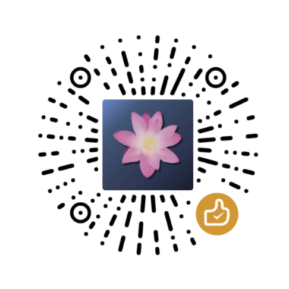

# RHI — ReShade HDR 安装器

**一个工具，通吃所有游戏。在单一窗口中完成完整的 HDR、DLSS 与 NVIDIA 驱动管理。**

RHI 会检测你在各主要商店平台的全部游戏库，并一键处理 ReShade、HDR mod、帧率限制器、DLSS 管理、OptiScaler、着色器包以及 NVIDIA 驱动配置文件。

---

## 下载

**[最新版本](https://github.com/RankFTW/RenoDXChecker/releases/latest)** · **[Discord](https://discord.gg/ultraplace)**

---

## 功能一览

### 一键为每个游戏启用 HDR

- **[RenoDX](https://github.com/clshortfuse/renodx)** — 自动检测并为每个游戏安装合适的 HDR mod。包含数百个量身定制的游戏专用 mod，并为没有专用 mod 的虚幻引擎和 Unity 游戏提供通用 HDR 支持。
- **UE-Extended** — 所有没有专用 mod 的虚幻引擎游戏的默认方案。自动为 `reshade.ini` 和 `Engine.ini` 配置正确的 HDR 设置，无需手动编辑 ini。
- **[Luma Framework](https://github.com/Filoppi/Luma-Framework)** — 游戏库中每个 DX11 虚幻引擎游戏都会自动获得 Luma 条目。为受支持的作品提供专用 mod，其余游戏提供通用支持。安装时自动从 wiki 应用 Engine.ini 键值、启动参数和 TAA 设置。
- **[DXVK + Lilium HDR](https://github.com/EndlesslyFlowering/dxvk)** — 为原本完全没有 HDR 路径的较旧 DX9 游戏带来 scRGB HDR 输出。
- **[RenoFX HDR Toolkit](https://github.com/clshortfuse/renofx)** — 为尚无专用 RenoDX mod 的任意游戏提供 SDR 到 HDR 转换。

### ReShade —— 全托管

RHI 完全取代 ReShade 安装器。

- 通过 PE 二进制扫描检测每个游戏的图形 API，并自动正确命名 DLL —— `dxgi.dll`、`d3d9.dll`、`opengl32.dll`。
- 每次启动都会暂存最新的稳定版和每夜版构建。
- 按游戏选择渠道：稳定版、每夜版、自定义、旧版或无插件。可在整个游戏库中自由混用。
- Vulkan 游戏使用全局隐式层 —— 一键安装，无需手动步骤。
- 外来 DLL 检测：如果游戏文件夹中已存在其他工具（DXVK、Special K、ENB），会在覆盖任何内容前提示你。
- 自动植入并合并 `reshade.ini` —— 热键、截图路径、峰值亮度和 DLSS 路径全部自动设置，无需任何手动配置。

### DLSS 5 与神经网络渲染

- **DLSS5 Feeder** — 一键完成整条管线安装：部署 feeder 插件、DLSS5 消费端、`nvngx_dlss.dll`、`nvngx_dlssnr.dll`、预配置的 `ReShadePreset.ini` 以及所需着色器包。自动为你的游戏选择正确方式（32 位、DX11、DX12）。
- **ShortFuse DLSS Tool** — 面向 DX12 游戏的另一种神经网络渲染实现。
- **DX11 Bridge 变体** — 适用于需要 DX11 兼容性的游戏的 DLSS5 Tool + 桥接。
- **NR Cost Scaler** — 包装 `nvngx_dlssnr.dll`，以更低的开销运行神经网络渲染（默认 75%）。在安装方式前开启该开关即可自动部署。

### DLSS 与 Streamline 版本管理

- 通过下拉菜单按游戏替换 SR、RR、FG 和 Streamline 版本。涵盖从 2.x 到当前的所有版本，以及自定义版本。
- 原始 DLL 自动备份，可随时恢复。
- 一次性设定全局默认值 —— 「快速应用」一键推送到任意游戏。
- 批量部署：从清单中勾选多个游戏，一次推送版本、预设和渲染缩放。
- DLSS 预设（SR 为 J/K/L/M，RR 为 D/E，FG 为 A/B）直接写入 NVIDIA 驱动配置文件，无需 Profile Inspector。
- **DLSS SR 渲染缩放覆盖** — 按游戏强制 33–100% 的渲染分辨率。
- **NVIDIA 覆盖** — 直接从版本下拉菜单按组件设置驱动的「最新 DLL」标记，等效于在 NVIDIA App 或 Profile Inspector 中启用。
- 依据 RHI manifest 自动更新 DLSS SR、RR 和 FG。可按游戏选择启用。

### 多帧生成

- **RTX 40 MFG 解锁** — 通过 Ultimate ASI Loader 在 RTX 40 系列上启用超过 2x（最高 6x）的 DLSS MFG 倍率。可从「附加」区块一键安装。
- **MFG Ada 解锁** — 通过插件管理器为 RTX 40 系列提供的内存级 MFG 解锁插件。
- **RTX 50 系列 MFG** — 在 DLSS 区块中配置固定或动态 MFG 模式、帧数（2x–6x）以及动态目标帧率。

### OptiScaler

- 将 DLSS API 调用重定向到 FSR4/FSR3/XeSS，供 AMD 和 Intel 显卡使用，并在游戏本身不支持时增加帧生成能力。
- 按游戏选择**稳定版和每夜版渠道**，在齿轮菜单中切换。
- **按显卡的 INI 模板** — 六个预配置模板（NVIDIA、AMD+DLSS、AMD 无 DLSS，各有稳定版和每夜版）。首次启动时植入，可由用户编辑，永不覆盖。
- **Streamline + DLSS Enabler 部署**（每夜版）— 按游戏切换，将 Streamline DLL 和 DLSS Enabler 部署到 OptiScaler 文件夹。可按游戏选择 Streamline 版本。
- 帧生成设置：FG 输入、FG 输出、FG Nvngx 替换、HUD 修复 —— 全部可在齿轮菜单中配置。
- **OptiPatcher** 自动部署到所有已安装 OptiScaler 的游戏，并静默自动更新。
- 自动处理与 ReShade 的共存 —— 调整文件名、设置 `LoadReshade=true`。

### 帧率限制器

两个互斥的按游戏帧率限制器：

- **[ReLimiter](https://github.com/RankFTW/ReLimiter)** — 带预测性休眠、锁相时序网格和闭环校正的精确帧节奏控制。感知 VRR，自适应 DLSS FG，集成 Reflex。
- **[Display Commander](https://github.com/pmnoxx/display-commander)** — 支持 32 位和 64 位游戏的替代限制器。

两者均以 ReShade 插件形式部署，且都参与「全部更新」。

### NVIDIA 驱动配置文件管理 —— 取代 NVIDIA App 与 Profile Inspector

所有按游戏的驱动设置直接通过 NvAPI 写入。无需 NVIDIA Profile Inspector，也无需 NVIDIA App。

**按游戏覆盖：**
- 垂直同步模式、撕裂控制、低延迟（关闭/开启/Ultra）
- 平滑运动：启用、允许的 API、Flip Pacing —— 启用时自动将低延迟设为 Ultra
- 电源管理模式
- 按游戏的 G-Sync 开关
- ReBAR：启用（关闭/开启/自动）、模式（标准/优化）、大小限制
- RTX HDR：启用/配置，含峰值亮度、对比度、饱和度、中灰、去色带
- DLSS 预设和渲染缩放覆盖（无需管理员权限）

**全局设置（基础配置文件）：**
- 着色器缓存大小与预编译
- G-Sync 模式与首选刷新率
- 全局 ReBAR
- 帧率限制（Frame Rate Limiter V3）
- 按显示器的数字振动 —— 每次应用启动时自动恢复

**导出/导入：** 将所有按游戏的 NVIDIA 配置文件备份为 JSON 文件。驱动重装后导入即可恢复一切。

### HDR 自动切换

通过 RHI 启动游戏时启用 Windows HDR，游戏关闭时禁用。适用于 Steam、Epic、Xbox 以及直接启动 exe。启动按钮旁的按游戏覆盖开关 —— 启用时显示为紫色。

### 着色器包管理 —— 46 个包

你想要的每个着色器包，都在一处管理：

- **必备**：Lilium HDR Shaders (EndlesslyFlowering) —— HDR 色调映射所需
- **推荐**：crosire reshade-shaders、PumboAutoHDR、MaxG2D Simple HDR、clshortfuse shaders、RenoFX HDR Toolkit、smolbbsoop shaders
- **附加**：另外 39 个包 —— SweetFX、OtisFX、qUINT、iMMERSE、Prod80、CorgiFX、ZenteonFX、CRT-Royale、VRToolkit、GShade-Shaders、QD-OLED APL Fixer、LumaBoost 等

可全局选择包，也可按游戏覆盖。展开任意包以挑选单个 `.fx` 文件 —— 三态复选框支持部分选择。将选择保存为命名配置、导出为 zip、直接分享到 Discord。

自定义着色器放入 `%LocalAppData%\RHI\Custom\reshade\Shaders\` —— RHI 会将它们与受管理的包一同部署。

### ReShade 插件管理

工具栏中的全局插件管理器。可按游戏或全局启用/禁用。`%LocalAppData%\RHI\Custom\Addons\` 中的自定义插件会自动出现在选择器中。

### 全部更新

工具栏中的一个按钮即可更新整个游戏库中的 ReShade、RenoDX、ReLimiter、Display Commander、OptiScaler 和 RE Framework。按游戏的更新排除设置会被尊重。有可用更新时按钮会亮起紫色。

运行期间每 4 小时后台检查一次，从系统托盘即可工作，无需保持窗口打开。

### Manifest 驱动的更新

游戏数据、mod 链接、Engine.ini 配置、启动修复和功能开关全部由每次启动时从 GitHub 获取的 manifest 驱动。这意味着：

- 新游戏支持、修复和调整会立即推送给所有用户 —— 无需更新应用
- 按游戏的 Engine.ini 覆盖（例如《黑神话：悟空》的自定义 HDR 键值）由服务端下发
- 功能开关可通过 manifest 为所有用户启用开发预览功能

---

## 支持的商店

Steam · Epic Games · GOG · Xbox / Game Pass · EA App · Ubisoft Connect · Battle.net · Rockstar · itch.io

如果未被自动检测到，可将任意游戏的 `.exe` 拖放到窗口上手动添加。

---

## 系统要求

- Windows 10 / 11
- [.NET 8 桌面运行时](https://dotnet.microsoft.com/download/dotnet/8.0)
- 驱动配置文件功能推荐使用 NVIDIA 显卡（ReShade 和 RenoDX 适用于所有显卡）
- 以下功能需要管理员模式：ReBAR、平滑运动、低延迟（Ultra）、Vulkan ReShade、驱动导出/导入

---

## 第三方组件

| 组件 | 作者 |
|-----------|--------|
| [ReShade](https://reshade.me) | Crosire |
| [RenoDX](https://github.com/clshortfuse/renodx) | clshortfuse & contributors |
| [ReLimiter](https://github.com/RankFTW/ReLimiter) | RankFTW |
| [Display Commander](https://github.com/pmnoxx/display-commander) | pmnoxx |
| [RE Framework](https://github.com/praydog/REFramework-nightly) | praydog |
| [Luma Framework](https://github.com/Filoppi/Luma-Framework) | Pumbo (Filoppi) |
| [OptiScaler](https://github.com/optiscaler/OptiScaler) | OptiScaler contributors |
| [DXVK](https://github.com/doitsujin/dxvk) | doitsujin & contributors |
| [DXVK HDR-mod](https://github.com/EndlesslyFlowering/dxvk) | EndlesslyFlowering (Lilium) |
| [Ultimate ASI Loader](https://github.com/ThirteenAG/Ultimate-ASI-Loader) | ThirteenAG |

---

## 关于中文版

本中文版为**非官方社区汉化**，基于原版 RHI（GPL-3.0）修改而成。

- **汉化范围**：程序界面、提示文案与对话框共 **1822 条**唯一字符串，已全量汉化（剩余未翻译项均为不可翻译的技术标识）
- **技术处理**：仅做字符串级精确替换，**未改动任何程序逻辑**。兼作数据键的字符串（如枚举值 `Full`/`Limited`、DLL 名称、JSON 键名）一律保留英文，避免破坏功能
- **原文保留惯例**：产品与技术专有名词（ReShade、RenoDX、OptiScaler、DXVK、Luma、ASI Loader、DLSS 等）保持英文，便于与官方文档对照
- **原版项目**：<https://github.com/RankFTW/RHI>
- **英文原版 README**：[README_EN.md](README_EN.md)
- **许可证**：本修改版同样以 **GPL-3.0** 授权，完整条款见 [LICENSE](LICENSE)

> 本汉化版与原作者 RankFTW 及 RHI 项目**无任何隶属关系**。
> 汉化相关问题请勿提交到原项目的 issue 区。

### 重新构建 / 跟进官方更新

汉化以「翻译字典 + 自动替换脚本」的形式维护，官方更新后可低成本重新应用：

```powershell
git -C RHI pull                     # 拉取官方新版
python localization\extract.py      # 重新扫描待翻译字符串
python localization\apply.py        # 套用已有字典（新增字符串自动保留英文）
powershell -File localization\pack_zh.ps1   # 重新打包中文版
```

依赖：.NET SDK 8 与 .NET 8 桌面运行时（Windows 10/11）。

---

## 赞赏

如果这个汉化对你有帮助，欢迎请我喝杯咖啡 ☕

<p align="center"></p>
